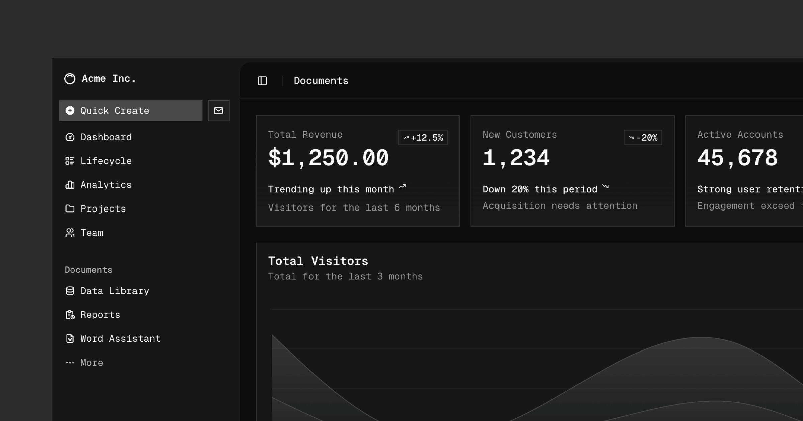

# basegear

[dalwoo-ru/base-ui](https://github.com/dalwoo-ru/base-ui) rebuilt as part of shadcn/ui, in Overgear colors, and cut down to what
`og-frontend-monorepo` actually uses: **Radix** primitives, **one style** (`baseui`), **Lucide** icons.
baseui is a shadcn style, a theme, a preset and a set of components in the shadcn registry, written in TypeScript/TSX + Tailwind.

## What is here

| Part | Where | What it is |
|---|---|---|
| Style `baseui` | `apps/v4/registry/styles/style-baseui.css` | The baseui look for every `cn-*` class: filled controls without outlines, 32/40/48/56px heights, 12px radius, solid selected states, shadowed surfaces, dialogs as bottom sheets on small screens. Builds as `radix-baseui`. |
| Theme `baseui` | `apps/v4/registry/themes.ts` | Overgear colors on the shadcn variables (`--primary` `#564fff`, navy neutrals, Overgear red/orange/green), light and dark. |
| Preset `baseui` | `packages/shadcn/src/preset/defaults.ts` | Style + theme + Lucide + Inter. Code: `b7qMHwHqa` (`BASEUI_PRESET` in `apps/v4/lib/config.ts`). |
| Components | `apps/v4/registry/bases/radix/ui/` | The shadcn components on Radix plus the baseui ones shadcn did not have: `segmented-control`, `rating`, `status`, `banner`, `chip`, `number-input`, `navbar`, `bottom-bar`, `layout`, `link`. Docs: `apps/v4/content/docs/components/radix/`. |
| Blocks | `apps/v4/registry/bases/radix/blocks/` | `messenger-01` and `product-01` (the Overgear product page), built from the registry components. |
| CLI | `packages/shadcn` | `npx shadcn add <name>` against this registry. |

## The site is the showcase

The whole site (`apps/v4`) is the design system's showcase, after baseui's docs: a catalog (Theming, Foundations,
Components and Blocks in groups), a page per component with a Playground and its Settings panel, props tables and examples
with code, desktop/mobile and light/dark switches. It is built from the `radix-baseui` components themselves, in the baseui
theme. The shadcn landing, docs, `/blocks`, `/create` and their routes are gone.

| Route | Page |
|---|---|
| `/` | Home: every page of the catalog |
| `/components/<name>` | Playground, props, examples |
| `/foundations/<name>`, `/theming/theme-settings` | Foundations and Theme Settings |
| `/blocks/<name>` | A block in a frame, with its install command |
| `/view/<name>` | The block alone (what the frame shows) |
| `/r/styles/radix-baseui/<name>.json` | The registry the shadcn CLI installs from |

| Part | Where |
|---|---|
| Frame: header, catalog, Settings panel, sheets | `apps/v4/showcase/shell.tsx` |
| Routes | `apps/v4/app/(showcase)`, blocks alone in `apps/v4/app/(block-view)` |
| Catalog groups | `apps/v4/showcase/catalog.ts` |
| Playgrounds (args, controls, render, code) | `apps/v4/showcase/stories/<component>.tsx` |
| Foundations and Theme Settings pages | `apps/v4/showcase/foundations/` |
| Examples, titles, descriptions | the demos in `apps/v4/examples/radix/`, in the order of `apps/v4/content/docs/components/radix/<component>.mdx` (kept as data for the showcase) |
| Props tables | `apps/v4/showcase/props.json`, from the TypeScript source: `pnpm --filter=v4 showcase:props` after changing a component |

## Removed from upstream shadcn

The Base UI and React Aria bases, the other eight styles (and their 27 base/style builds), the legacy `new-york-v4`
registry with its blocks, charts and examples, AI Elements, the Charts, Colors, Typeset and `/examples` sections, RTL,
the changelog, the forms and AI helper guides, the whole shadcn docs site (landing, docs, `/blocks`, `/create`, fumadocs), the starter `templates/`, `packages/tests` and the upstream release,
registry-monitoring and signed-commit workflows. The site picks Lucide only. The build renders 147 pages instead of 843
and peaks at about 3.6 GB of memory.

## Run

```sh
pnpm install
pnpm --filter=v4 registry:build   # generates styles/radix-baseui/ui and public/r
pnpm --filter=v4 dev              # http://localhost:4000
```

- The showcase: http://localhost:4000, a component at `/components/<name>`, a block at `/blocks/<name>`.
- Install from it: `npx shadcn@latest add <site URL>/r/styles/radix-baseui/<name>.json`.

## Deploy on Vercel

Set the project's **Root Directory** to `apps/v4` (keep "Include files outside the root directory" on), framework Next.js,
default build and install commands.

## Font

shadcn's font registry only takes Google Fonts, so the preset uses Inter. Overgear's TT Interphases Pro is a commercial font;
in an app, load it with `next/font/local` and point `--font-sans` at it.

## Adding a component the shadcn way

1. `apps/v4/registry/bases/radix/ui/<name>.tsx`: `data-slot` on every part, `cn-<name>-*` classes, `cva` variants.
2. An entry in `apps/v4/registry/bases/radix/ui/_registry.ts`.
3. A `cn-<name>` section in `apps/v4/registry/styles/style-baseui.css`.
4. Demos in `apps/v4/examples/radix/`, a page in `apps/v4/content/docs/components/radix/` (+ `meta.json`) for its title, description and example order, a group in `apps/v4/showcase/catalog.ts`, optionally a Playground in `apps/v4/showcase/stories/`.
5. `pnpm --filter=v4 registry:build` and `pnpm --filter=v4 showcase:props`.

---

# shadcn/ui

A set of beautifully designed components that you can customize, extend, and build on. Start here then make it your own. Open Source. Open Code. **Use this to build your own component library**.



## Documentation

Visit https://ui.shadcn.com/docs to view the documentation.

## Contributing

Please read the [contributing guide](/CONTRIBUTING.md).

## License

Licensed under the [MIT license](./LICENSE.md).
